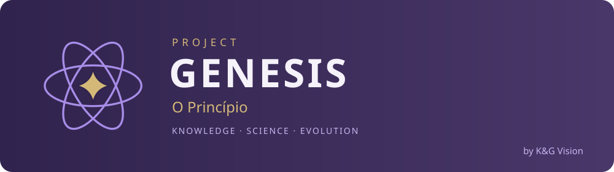

# Project Genesis — Sabedoria e Aplicação

**Knowledge · Science · Evolution**  
*by K&G Vision*

[Portal](https://kgasil.github.io/genesis/) · [Português](#português) · [English](#english)

## Português

O Project Genesis é um projeto próprio e independente de estudos, pesquisa e compartilhamento de conhecimento. Nasceu da nossa vontade de aprender, melhorar nossas competências, explorar ciência e tecnologia e ajudar outras pessoas a estudar por conta própria.

### O que está disponível hoje

A apresentação pública da iniciativa, seus objetivos e os temas que estudamos. Nenhum guia está disponível para download neste momento.

### O que pretendemos compartilhar

- 10 guias de revisão do conteúdo principal, dentre 75 documentos planejados para nosso acervo de estudos.
- Referências e links de terceiros, priorizando recursos gratuitos.
- Sugestões de temas de estudo e ideias de prática independente.

Os guias serão publicados somente após revisão técnica, editorial e de direitos autorais. Os demais documentos permanecem internos.

### Limites do projeto

Não somos uma instituição de ensino e não possuímos reconhecimento acadêmico oficial. Não oferecemos formação, cursos próprios, aulas, matrículas, tutoria, avaliações, diplomas ou certificados. Eventuais cursos recomendados são de terceiros. O portal não tem finalidade comercial.

## English

Project Genesis is our self-directed, independent study and research project. We aim to improve our own skills, explore science and technology, and share useful knowledge with others.

**Available now:** the project overview and topics we study. No guides are available for download yet.

**Planned:** 10 public review guides from our planned collection of 75 documents, external references, free third-party resource recommendations, and ideas for independent practice. Publication is subject to technical, editorial and copyright review. Other documents remain internal.

Genesis is not an educational institution, has no official academic recognition, and does not offer formal training, its own courses, classes, enrollment, tutoring, assessments, diplomas or certificates. The portal is non-commercial.

## Ecosystem / Ecossistema

| Project | Website | Repository | Current stage / Etapa atual |
| --- | --- | --- | --- |
| K&G Vision | [Institutional](https://kgasil.github.io/) | [Source](https://github.com/Kgasil/kgasil.github.io) | Independent initiative / Iniciativa independente |
| Project Genesis | [Sabedoria e Aplicação](https://kgasil.github.io/genesis/) | [Source](https://github.com/Kgasil/genesis) | Independent studies; 10 review guides planned, none published / Estudos independentes; 10 guias previstos, nenhum publicado |
| Project Vision | [Security & Efficiency](https://kgasil.github.io/vision/) | [Source](https://github.com/Kgasil/vision) | Local demonstration lab / Laboratório demonstrativo local |
| Project Aeris | [Discreet & Efficient. / Discreto e Eficiente.](https://kgasil.github.io/aeris/) | [Source](https://github.com/Kgasil/aeris) | Product concept; no downloadable release / Conceito de produto; sem versão para download |
| Project Lilium | [Where strategy meets intelligence.](https://kgasil.github.io/lilium/) | [Source](https://github.com/Kgasil/lilium) | Local metrics prototype; business suite planned / Protótipo local de indicadores; aplicação empresarial em planejamento |

**Learn · Build · Simplify · Transform / Aprender · Construir · Simplificar · Transformar**

## Website

- `index.html` — bilingual, responsive study project preview.
- `assets/genesis-symbol.svg` — orbital spark.
- `assets/brand-banner.svg` — project identity.

Open `index.html` in a browser; no backend or build step is required. The site is configured for GitHub Pages from `main` at `/ (root)`. The public repository does not include internal study documents.

Public visibility is not a license to redistribute materials. License terms are not yet specified.

## Identidade K&G Vision / K&G Vision identity

[Versão vertical / Vertical lockup](https://github.com/Kgasil/kgasil.github.io/blob/main/assets/brand-stacked.svg) · [Escudo / Shield](https://github.com/Kgasil/kgasil.github.io/blob/main/assets/kg-symbol.svg)

Official visual lockup: **K&G** above **Vision**; individual project symbols are retained. / Assinatura visual oficial: **K&G** acima de **Vision**, mantendo os símbolos individuais dos projetos.

**Genesis (purple) · Vision (blue) · Aeris (green) · Lilium (rose)**

[Experimentar Lilium Insights / Try Lilium Insights (PT-BR)](https://kgasil.github.io/lilium/demo.html) — local prototype, no connected AI or commercial offering.
