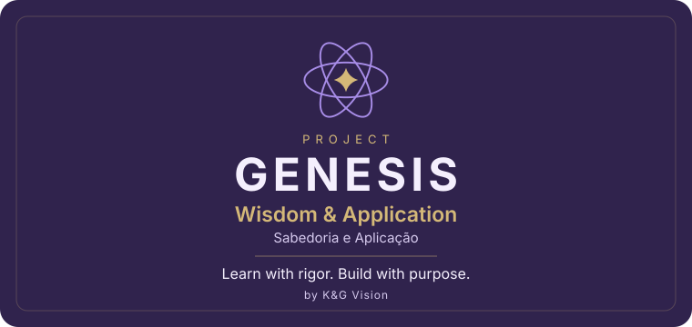

> [!WARNING]
> **AVISO IMPORTANTE DE SEGURANÇA — Genesis Mini 0.1.0 (26/11/2026)**
>
> O Microsoft Defender detectou o pacote ZIP 0.1.0 como Trojan:Script/Ulthar.A!ml (ThreatID 2147751841), com alerta grave, e removeu o arquivo. A amostra foi submetida à Microsoft em 26/11/2026 para análise oficial; o parecer permanece pendente. Não há confirmação de falso positivo ou liberação. Nunca recomendamos desativar o Windows Defender, ignorar alertas ou restaurar arquivos em quarentena. A instalação permanece suspensa; o laboratório web está disponível sem instalação.
>
> Microsoft Defender detected the 0.1.0 ZIP as Trojan:Script/Ulthar.A!ml (ThreatID 2147751841), rated severe, and removed the file. The sample was submitted to Microsoft on November 26, 2026 for official review; the verdict is pending. No false-positive determination or clearance has been confirmed. We never recommend disabling Windows Defender, bypassing warnings or restoring quarantined files. Installation remains paused; the web lab is available without installation.
>
> [Incidente oficial](https://github.com/Kgasil/genesis/issues/1) · [Mini Lab web](https://kgasil.github.io/genesis/mini/)

# Project Genesis — Sabedoria e Aplicação

<!-- kg-personal-portfolio-v1 -->

**Idealizador / Creator:** [Kaio Gabriel da Silva — KG Professional Portfolio 1.0](https://kgasil.github.io/portfolio/) · [GitHub](https://github.com/Kgasil) · [LinkedIn](https://www.linkedin.com/in/kaio-gabriel-da-silva). Portfólio pessoal independente do projeto / Personal portfolio separate from this project.

<!-- kg-current-training -->
**Formação e trajetória do idealizador / Creator's education and experience:** [Currículo público atualizado / Updated public résumé](https://kgasil.github.io/portfolio/resume.html) · [Portfólio / Portfolio](https://kgasil.github.io/portfolio/). A formação pessoal é independente dos produtos e materiais do projeto / Personal training is independent of project products and materials.

**Wisdom & Application · Sabedoria e Aplicação**  
*Learn with rigor. Build with purpose.*  
*by K&G Vision*

[Portal](https://kgasil.github.io/genesis/) · [Português](#português) · [English](#english)

> **Marco 1.0 — Acervo editorial e biblioteca pública / Editorial collection and public library.** 75 PDFs privados, 3.277 páginas, 60 volumes, 10 guias e 5 complementos; 11 áreas públicas com leituras e demonstrações. Não é curso ou certificação; a conclusão editorial não equivale à conclusão dos estudos.

**Papel no ecossistema / Ecosystem role:** No ecossistema K&G Vision, o Genesis oferece fundamentos e referências de estudo para orientar futuras iniciativas de pesquisa e desenvolvimento. / Within the K&G Vision ecosystem, Genesis provides learning foundations and references to inform future research and development.

## Marco 02 — Business & Management (em desenvolvimento / in development)

[**Biblioteca de Negócios e Gestão / Business & Management library**](https://kgasil.github.io/genesis/business.html) — cinco pastas de área com leituras introdutórias, 40 resumos de volumes planejados: 10 comerciais, 10 financeiros, 10 contábeis, 5 administrativos e 5 competências estratégicas. / Five area folders with introductory readings and 40 planned volume summaries: 10 sales, 10 finance, 10 accounting, 5 management and 5 strategic skills.

O Marco 1.0 permanece intacto: 75 PDFs privados, 4.000 horas nominais. Plano combinado: 115 documentos, meta de 5.280 páginas e 6.000 horas de estudo autônomo; não representa produção ou conclusão de estudos. PDFs integrais complementares não publicados. / Milestone 1.0 remains intact: 75 private PDFs, 4,000 nominal hours. Combined plan: 115 documents, target 5,280 pages and 6,000 self-study hours; not a claim of production or study completion. Complementary full PDFs are not published.

**Progresso editorial / Editorial progress (27/11/2026):** C01–C10, F01–F10 e A01–A10: 30 edições de trabalho privadas, 1.500 páginas físicas. Contabilidade III produzida; auditoria estrutural e numérica parcial dos volumes anteriores realizada; A01/A02 corrigidos. Revisão acadêmica integral e meta 9/10 pendentes. / 30 private working editions, 1,500 physical pages; Accounting III produced, partial structural and numerical review of previous volumes completed, A01/A02 corrected. Full academic review and 9/10 target pending.

[Plano editorial / Editorial plan](docs/business-management-plan.md)

## Biblioteca interativa / Interactive library

[**Abrir as 11 pastas de leitura e mini ferramentas / Explore all 11 reading folders and mini tools**](https://kgasil.github.io/genesis/biblioteca.html)

[Volume 00 — Guia geral / General guide](https://kgasil.github.io/genesis/biblioteca.html#m00) · 10 módulos com amostras de leitura e demonstrações interativas locais. Os exemplos são didáticos e os PDFs completos continuam privados. / 10 modules with reading previews and local interactive demonstrations. Full PDFs remain private.

**Novidades da biblioteca / Library features:** busca bilíngue por assuntos, 11 desafios com explicações, 11 mini ferramentas e marcações pessoais de leitura salvas no navegador (quando o armazenamento local está disponível). / Bilingual topic search, 11 explained discovery challenges, 11 mini tools and local reading marks (when browser storage is available). Sem conta, curso, nota ou certificado. / No account, course, grade or certificate.

**Leituras ampliadas / Expanded readings:** 11 artigos com quatro seções temáticas cada, totalizando 4.020 palavras em português e 3,520 em inglês, baseados nos dez guias integrados e no V00. A leitura é opcional: clique na pasta para abrir e clique novamente para fechar. / 11 articles with four thematic sections each, based on the ten integrated guides and Volume 00. Reading is optional: click a folder to expand it and click again to collapse it. Os PDFs integrais continuam privados. / Full PDFs remain private.

**Miniartigos temáticos / Thematic mini articles:** cada uma das 11 áreas contém uma pasta interna expansível com introdução e definição, fundamentos, aplicação ilustrativa e considerações finais. Textos de contextualização conceitual assistidos por IA, não TCCs acadêmicos ou pesquisas revisadas por pares. / Each of the 11 areas includes an expandable reading folder with introduction, foundations, illustrative application and conclusions. AI-assisted conceptual context, not academic theses or peer-reviewed research. As 22 pastas de leitura (11 miniartigos temáticos + 11 leituras ampliadas) iniciam fechadas. Os 11 desafios e 11 mini laboratórios permanecem acessíveis independentemente da leitura. / All 22 reading folders (11 thematic mini articles + 11 expanded readings) start collapsed. The 11 challenges and 11 mini labs remain independently accessible.

## Genesis Mini — apoio ao estudo / study companion (0.1.0)

Complemento gratuito, sem novo marco, sem mudanças no acervo, módulos ou versões existentes. / Free complementary sample; no new milestone or changes to the collection, modules or existing versions.

| Recurso / Tool | Acesso / Access |
| --- | --- |
| **Mini Lab** — leitura em blocos, estimativa de tempo, roteiro de exercícios e comparação numérica com referência fornecida pelo usuário / reading blocks, time estimate, exercise checklist and numeric comparison | [Abrir aplicativo / Open app](https://kgasil.github.io/genesis/mini/) |
| **Mini Extension** — leitura e roteiro de exercícios / reading and exercise checklist | [Mini Lab web — sem instalação / no installation](https://kgasil.github.io/genesis/mini/) · [Tutorial](https://kgasil.github.io/genesis/#instalar-extensao) |

### Instalação manual / Manual installation

1. Baixe e extraia o ZIP em uma pasta permanente.
2. Abra `chrome://extensions/` ou `edge://extensions/` no computador.
3. Ative o modo desenvolvedor, se permitido, e escolha Carregar sem compactação.
4. Selecione a pasta que contém `manifest.json`.
5. Abra Genesis Mini e use o exemplo de leitura ou exercício.

Para atualizar, substitua os arquivos da pasta e clique em Recarregar; para desinstalar, clique em Remover. Não contorne políticas administrativas. [Tutorial detalhado](extension/README.md).

English: download and extract the ZIP, open the browser extensions page, enable Developer mode if permitted, choose Load unpacked and select the extracted folder containing manifest.json. Open Genesis Mini. Reload to update; Remove to uninstall.

Sem conta, IA conectada, envio automático, permissões especiais ou armazenamento persistente. Não acessa PDFs automaticamente nem oferece respostas prontas, tutoria, notas ou certificados. Teste manual de navegador pendente; não publicado nas lojas. / Local-only, no account, connected AI, automatic transmission, special permissions or persistent storage. No automatic PDF access, answer generation, tutoring, grades or certificates. Manual browser testing pending; not in stores.

**Validação / Validation:** 19 verificações determinísticas em `node tests/mini.test.js`. [Documentação da extensão](extension/README.md).

## Português

O Project Genesis é uma iniciativa independente de estudos e pesquisa da K&G Vision, desenvolvida com assistência de IA. O acervo editorial reúne **75 PDFs completos, 3.277 páginas, 60 volumes temáticos, 10 guias integrados e 5 documentos complementares**. A carga de 4.000 horas é nominal e estimada para estudo autônomo, não certificada.

**O portal publica apenas amostras do Volume 00 e dos dez módulos, com leituras e demonstrações interativas.** Para solicitar os arquivos completos, entre em contato diretamente com [Kaio Gabriel da Silva pelo LinkedIn](https://www.linkedin.com/in/kaio-gabriel-da-silva) e combine as condições de acesso. Não há download público do acervo.

| Módulo | Guia público (resumo) | Temas |
| --- | --- | --- |
| 01 | [Digital Foundations](https://kgasil.github.io/genesis/biblioteca.html#m01) | Computadores, lógica, Git, Python, Java e estruturas de dados. |
| 02 | [Data Intelligence](https://kgasil.github.io/genesis/biblioteca.html#m02) | Estatística, SQL, pandas, Power BI, DAX e pipelines ETL. |
| 03 | [Software Engineering](https://kgasil.github.io/genesis/biblioteca.html#m03) | Redes, HTTP, frontend, APIs, testes, QA e automação. |
| 04 | [Cyber Defense](https://kgasil.github.io/genesis/biblioteca.html#m04) | Linux, riscos, identidade, criptografia, redes, SOC e resposta a incidentes. |
| 05 | [Advanced Cybersecurity](https://kgasil.github.io/genesis/biblioteca.html#m05) | Zero Trust, Secure Coding, Threat Modeling, AppSec, testes autorizados, forense e GRC. |
| 06 | [Artificial Intelligence Engineering](https://kgasil.github.io/genesis/biblioteca.html#m06) | ML, deep learning, IA generativa, LLMs, RAG, agentes e avaliação de IA. |
| 07 | [Enterprise Technology Engineering](https://kgasil.github.io/genesis/biblioteca.html#m07) | Cloud, Docker, Kubernetes, DevSecOps, segurança de dependências, MLOps e observabilidade. |
| 08 | [Advanced Computer Science & Applied Mathematics](https://kgasil.github.io/genesis/biblioteca.html#m08) | Lógica formal, álgebra linear, cálculo, otimização, probabilidade, algoritmos e sistemas distribuídos. |
| 09 | [Advanced AI & Cybersecurity Research](https://kgasil.github.io/genesis/biblioteca.html#m09) | ML e deep learning avançados, Transformers, LLMs, RL, privacidade e robustez. |
| 10 | [Advanced AI Security, Research & Innovation Engineering](https://kgasil.github.io/genesis/biblioteca.html#m10) | Metodologia científica, arquitetura de IA, segurança, privacidade, AI Assurance, auditoria e simulação. |

Os resumos incluem exemplos de prática e conhecimentos úteis para áreas como dados, BI, software, infraestrutura, automação, engenharia de IA, segurança e avaliação de modelos. Não garantem emprego ou habilitação profissional.

O Genesis não é uma instituição de ensino e não oferece cursos, aulas, matrículas, tutoria, diplomas ou certificados. Os materiais são destinados a estudo independente, com revisão crítica e práticas autorizadas.

## English

Project Genesis is an independent AI-assisted study and research initiative by K&G Vision. Its collection consists of **75 complete PDFs, 3,277 pages, 60 topic volumes, 10 integrated guides and 5 companion documents**. The 4,000 nominal self-study hours are estimates, not certified hours.

Only public reading previews and interactive demonstrations for Volume 00 and the ten modules are available in the [library](https://kgasil.github.io/genesis/biblioteca.html). To request the complete files and discuss access conditions, [contact Kaio Gabriel da Silva directly on LinkedIn](https://www.linkedin.com/in/kaio-gabriel-da-silva). No public PDF downloads are provided.

The materials support independent study across data, software, infrastructure, AI engineering, cybersecurity and AI assurance. Career examples are illustrative; employment and qualifications are not guaranteed. Genesis is not an educational institution and provides no courses, classes, enrollment, tutoring, diplomas or certificates.

## GRAAL — Ecosystem / Ecossistema · Marco 01

| Project | Website | Repository | Current stage / Etapa atual |
| --- | --- | --- | --- |
| K&G Vision | [Institutional](https://kgasil.github.io/) | [Source](https://github.com/Kgasil/kgasil.github.io) | Independent initiative / Iniciativa independente |
| Project Genesis | [Wisdom & Application / Sabedoria e Aplicação](https://kgasil.github.io/genesis/) | [Source](https://github.com/Kgasil/genesis) | **1.0 — Editorial & Library / Acervo e biblioteca.** 75 private study PDFs; [public interactive library](https://kgasil.github.io/genesis/biblioteca.html) / 75 PDFs privados; biblioteca pública interativa, sem cursos ou certificados. · [Genesis Mini — complemento gratuito](https://kgasil.github.io/genesis/mini/) · [Instalar extensão / Install extension](https://kgasil.github.io/genesis/#instalar-extensao) |
| Project Rubedo | [Science & Innovation / Ciência e Inovação](https://kgasil.github.io/rubedo/) | [Source](https://github.com/Kgasil/rubedo) | **Marco 01 — Public Lab 1.0.** [Research Workspace 1.0](https://kgasil.github.io/rubedo/research/) · [Mini Lab 1.0.0](https://kgasil.github.io/rubedo/mini/) · [Instalação manual / Manual installation](https://kgasil.github.io/rubedo/#instalar); experimental, no store distribution. |
| Project Argus | [Security & Development / Segurança e Desenvolvimento](https://kgasil.github.io/argus/) | [Source](https://github.com/Kgasil/argus) | **1.0 — Public Research Lab / Laboratório público.** Technical baseline V10.2; local demonstrations / Base técnica V10.2; demonstrações locais, não serviços de produção. [Argus Mini — amostra complementar / complementary sample](https://kgasil.github.io/argus/mini/), v0.1.0; original milestone unchanged / marco original preservado. · [Instalar extensão / Install extension](https://kgasil.github.io/argus/#instalar-extensao) |
| Project Aeris | [Efficiency & Simplicity / Eficiência e Simplicidade](https://kgasil.github.io/aeris/) | [Source](https://github.com/Kgasil/aeris) | **1.0 — Extension 1.0.0; Desktop 1.1.0 RC1.** Public experimental preview, not stable / Prévia pública experimental, não estável. [Desktop e extensão — instalação, avisos e evidências / installation, warnings and evidence](https://kgasil.github.io/aeris/#instalacao) |
| Project Lilium | [Strategy & Evolution / Estratégia e Evolução](https://kgasil.github.io/lilium/) | [Source](https://github.com/Kgasil/lilium) | **1.0 — Web Lab.** Public demo / demonstração pública; Desktop v0.14.0 controlled preview / prévia controlada; [Mini v0.1.1](https://github.com/Kgasil/lilium/tree/main/extension) experimental. |

**Version note / Nota de versão:** 1.0 identifies the first completed public-facing project milestone of the ecosystem, not a uniform software release tag. Genesis is an editorial milestone; Argus retains technical baseline V10.2; Aeris 1.0.0 applies to Extension; Lilium 1.0 applies to Web Lab. / 1.0 identifica o primeiro marco público do ecossistema, não uma tag de software uniforme. Genesis é um marco editorial; Argus mantém a base V10.2; Aeris 1.0.0 refere-se à extensão; Lilium 1.0 refere-se ao Web Lab. Desktop previews are not stable releases / Prévias Desktop não são versões estáveis.

**Learn · Build · Protect · Simplify · Evolve / Aprender · Construir · Proteger · Simplificar · Evoluir**

## Website

- `index.html` — bilingual, responsive catalog of ten module summaries.
- `biblioteca.html` — eleven module areas (V00 + M01–M10), 22 collapsible reading folders, 11 mini labs, 11 explained challenges, bilingual search and optional local reading marks (no backend).
- `assets/genesis-symbol.svg` — orbital spark.
- `assets/brand-banner.svg` — project identity.

Open `index.html` in a browser; no backend or build step is required. The site is configured for GitHub Pages from `main` at `/ (root)`. The public repository contains previews only; full PDFs are requested directly from the owner.

Public visibility is not a license to redistribute materials. License terms are not yet specified.

## Identidade K&G Vision / K&G Vision identity

[Versão vertical / Vertical lockup](https://github.com/Kgasil/kgasil.github.io/blob/main/assets/brand-stacked.svg) · [Escudo / Shield](https://github.com/Kgasil/kgasil.github.io/blob/main/assets/kg-symbol.svg)

Official visual lockup: **K&G** above **Vision**; individual project symbols are retained. / Assinatura visual oficial: **K&G** acima de **Vision**, mantendo os símbolos individuais dos projetos.

**Genesis (purple) · Rubedo (orange/gold) · Argus (blue) · Aeris (green) · Lilium (rose)**

O escudo institucional preserva as quatro cores laterais e o núcleo branco; Rubedo ocupa apenas as pontas centrais superior (laranja) e inferior (dourado). / The institutional shield preserves its four side colors and white core; Rubedo occupies only the upper (orange) and lower (gold) central tips.

[Lilium Interactive Lab / Laboratório interativo](https://kgasil.github.io/lilium/#lab) · [Insights CSV demo](https://kgasil.github.io/lilium/demo.html) — browser-based synthetic exercises; no connected AI or commercial offering.

**Lilium Mini v0.1.1 — GitHub-only / exclusivamente pelo GitHub:** [Installation tutorial / Tutorial de instalação](https://github.com/Kgasil/lilium/tree/main/extension) · Chrome & Edge, manual installation with synthetic data / instalação manual com dados fictícios. Not published in extension stores / não publicado nas lojas.

**25 NOV 2026 — Lilium Web Lab 1.0:** [Comunicado / Announcement](https://github.com/Kgasil/lilium/blob/main/docs/web-lab-v1.0.md) · Public browser demonstrations / Demonstrações públicas no navegador. Desktop v0.14.0 remains a controlled preview / continua em prévia controlada.

**Aeris Extension 1.0.0** — 16 ferramentas, 50 testes automatizados aprovados; instalação manual disponível pelo GitHub. / 16 tools, 50 automated tests passed; manual installation available on GitHub. [Instalação / Installation](https://kgasil.github.io/aeris/extension-preview.html) · [Notas / Release notes](https://github.com/Kgasil/aeris/blob/main/release/extension-1.0.0-notes.md).

 **GRAAL · Marco 01** — identidade integrada / integrated identity.

**GRAAL — Construir / Build (Rubedo):** [Rubedo Research Workspace](https://kgasil.github.io/rubedo/research/) · [Precisão / Precision (R06)](https://kgasil.github.io/rubedo/research/#precisao) · [Monte Carlo (R07)](https://kgasil.github.io/rubedo/research/#monte-carlo). Modelos experimentais; CI de integridade e interface registrada em 27/11/2026 ([evidência / evidence](https://github.com/Kgasil/rubedo/actions/runs/46007461543)), sem validação científica ou industrial. / Experimental models; package and interface CI recorded, no scientific or industrial validation.

**Rubedo — edição 1.0 / 1.0 edition:** [Research Workspace 1.0](https://kgasil.github.io/rubedo/research/) · [Mini Lab 1.0.0](https://kgasil.github.io/rubedo/mini/) · [Mini Extension 1.0.0 — instalação manual / manual installation](https://kgasil.github.io/rubedo/#instalar). Edição experimental / Experimental edition.

**[Central de distribuição GRAAL / GRAAL distribution center](https://kgasil.github.io/distribuicao.html)** — versões, canais oficiais, limitações e estado de segurança / versions, official channels, limitations and security status.

<!-- graal-governance-v1:start -->
## Governança GRAAL / GRAAL governance

[**Catálogo central de componentes, versões, segurança e maturidade / Central catalog of components, versions, security and maturity**](https://github.com/Kgasil/kgasil.github.io/blob/main/docs/graal-catalog.md) · [Central de distribuição / Distribution center](https://kgasil.github.io/distribuicao.html)

O catálogo é a referência institucional para o estado atual; registros históricos e avisos específicos deste repositório permanecem aplicáveis. Em caso de divergência, prevalece o estado mais restritivo. / The catalog is the institutional reference for current status; this repository's historical records and specific notices remain applicable. If records disagree, the most restrictive state prevails.
<!-- graal-governance-v1:end -->
